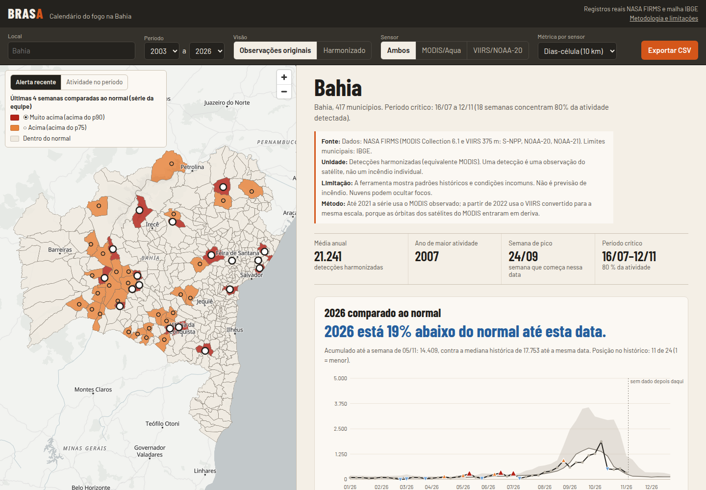
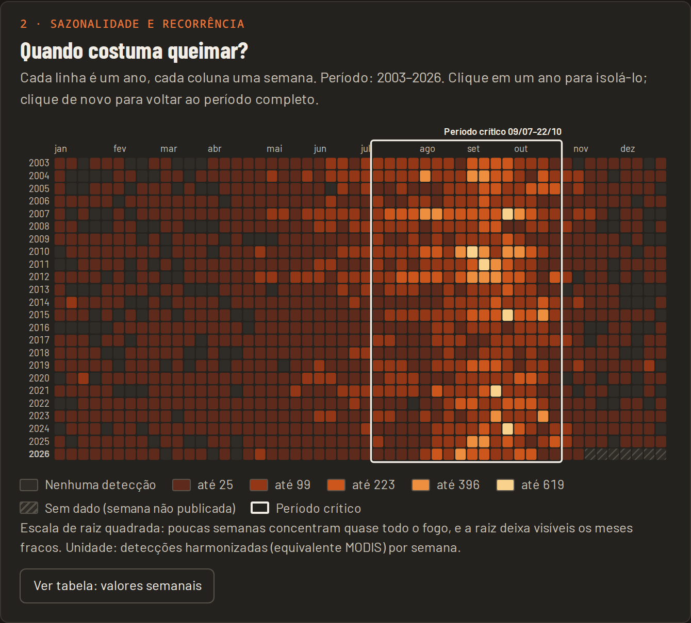
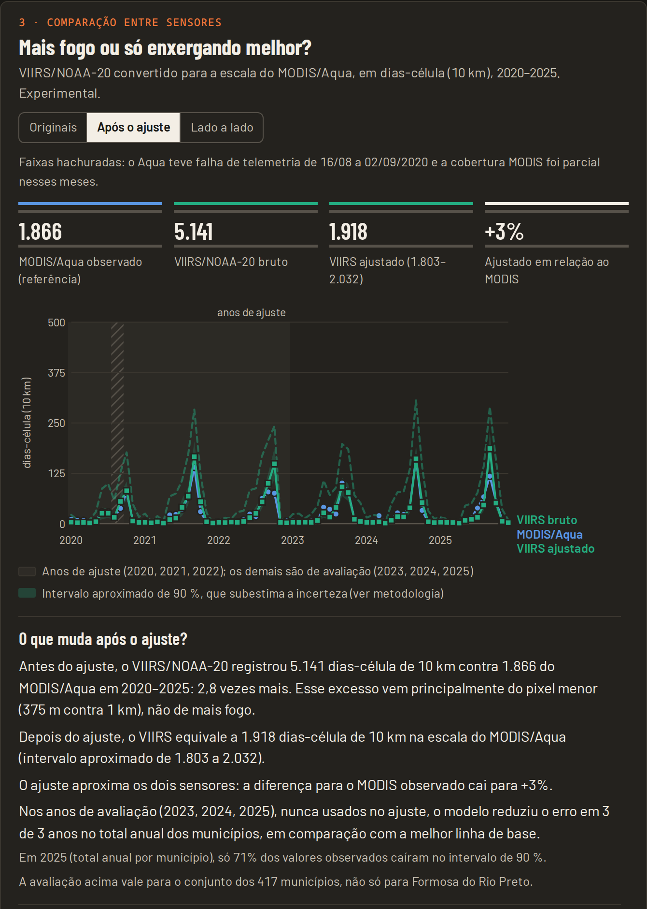
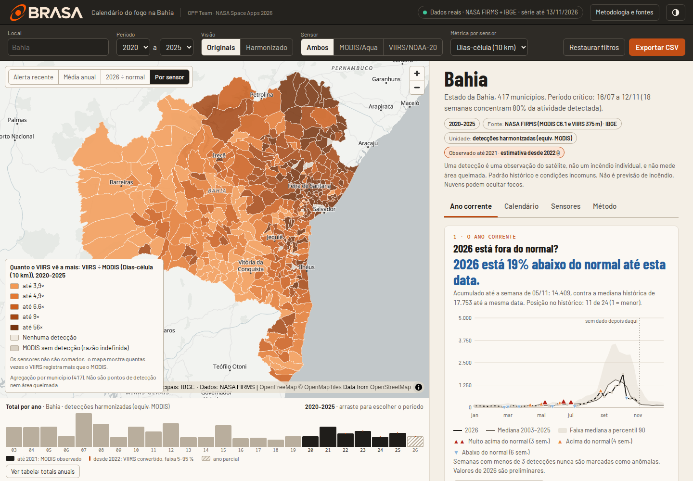
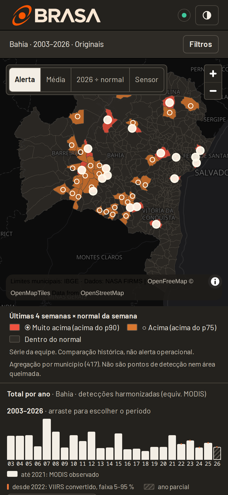

# BRASA: calendário do fogo na Bahia

**OPP Team, NASA Space Apps Challenge 2026, desafio *Harmonization of MODIS and VIIRS Hot Spots*.**

> "Estamos observando mais fogo ou apenas enxergando melhor?"

O BRASA transforma registros NASA FIRMS em um calendário explicável da
atividade de fogo detectada na Bahia e nos seus 417 municípios. Ele mostra,
sempre separados:

- a série harmonizada da equipe (2003–2026);
- os registros originais MODIS/Aqua e VIIRS/NOAA-20 (2020–2025);
- uma harmonização experimental com treino e avaliação separados;
- uma auditoria independente da série da equipe.

## Telas



| Calendário ano × semana (Formosa do Rio Preto) | "Mais fogo ou só enxergando melhor?" após o ajuste |
|---|---|
|  |  |

| Tema claro: mapa por sensor (VIIRS ÷ MODIS) | Celular |
|---|---|
|  |  |

## O que funciona

- **Identidade BRASA**: logo nova, tema escuro como padrão e tema claro
  (para sala iluminada e impressão) no botão ◐. A escolha fica salva no
  navegador.
- **Português e inglês**: o seletor **PT | EN** fica no cabeçalho, também no
  celular, e troca toda a interface: textos, frases calculadas, legendas,
  tabelas, números (14.409 → 14,409) e datas (16/07 → Jul 16). Na primeira
  visita, o site segue o idioma do navegador; depois, vale a escolha salva.
  Para enviar um link já em inglês, acrescente `?lang=en` (exemplo:
  `…/?lang=en&local=2911105&aba=sens`). Os JSON continuam em português; a
  tradução dos textos que vêm deles fica em `web/src/i18n/dataText.ts`.
- **Mapa** dos 417 municípios (MapLibre), com quatro modos:
  - **Alerta recente**: últimas 4 semanas comparadas ao normal da semana
    (série da equipe);
  - **Média anual** por 1.000 km²;
  - **2026 ÷ normal**: o ano corrente dividido pelo normal;
  - **Por sensor**: atividade no período por sensor. Com ambos os sensores,
    mostra a razão VIIRS ÷ MODIS, nunca a soma.
  - Clique ou busque um município para selecioná-lo.
- **Total por ano** (2003–2026) abaixo do mapa: arraste sobre as barras para
  escolher o período; a tabela com os totais fica a um clique.
- **Filtros compartilhados**: local, período, visão (original ou harmonizada),
  sensor e métrica. Valem para mapa, calendários, gráficos e CSV, ficam
  espelhados na URL e voltam ao padrão com "Restaurar filtros".
- **Painel em quatro abas**, cada uma respondendo uma pergunta:
  - **Ano corrente** ("2026 está fora do normal?"): curva semanal sobre a
    faixa mediana–p90, classes de anomalia (glifo e cor) e frase de destaque;
  - **Calendário** ("Quando costuma queimar?"): ano × semana (2003–2026), com
    período crítico, escala de raiz quadrada e "sem dado" diferente de "sem
    detecção". Clique num ano para isolá-lo. Inclui o calendário mês × ano
    por sensor (2020–2025);
  - **Sensores** ("Mais fogo ou só enxergando melhor?"): MODIS/Aqua, VIIRS
    bruto e VIIRS ajustado, em alternância ou lado a lado. A visão
    harmonizada responde "O que muda após o ajuste?" com textos calculados a
    partir dos valores, e confere a série da equipe com o MODIS observado;
  - **Método** ("Como ler estes dados"): fontes com SHA-256, critérios de
    qualidade por sensor e ano, deriva orbital medida, avaliação do ajuste
    com marcações automáticas, e limitações.
- **Responsivo**: no celular os filtros abrem numa gaveta e o conteúdo vem
  logo abaixo do mapa; calendários e gráficos se ajustam à largura.
- **Exportação CSV** do recorte filtrado, com camada, tipo de dado, versão do
  produto e filtros em cada linha.
- **Estados** de carregamento, erro, município sem detecção, período sem dados
  por sensor, camada indisponível e mapa de fundo offline.

## Dados: o que é real e o que é sintético

| Camada | Origem | Situação |
|---|---|---|
| A: `web/public/api/` | Pacote `api.rar` da equipe | Real, usado como recebido. Os scripts que o geraram não estão aqui, então a validação de "2,2 %" **não foi reproduzida**. |
| B: `web/public/data/real/` | 12 arquivos anuais FIRMS (MODIS e VIIRS-NOAA-20, 2020–2025) e malha IBGE, todos com SHA-256 conferido | **Real**, gerado por `pipeline/` |
| Exemplo: `pipeline/examples/firms/` | ~2.300 linhas reais copiadas desses arquivos (Formosa do Rio Preto, 1–7/set/2024) | Real, para testar o pipeline |
| Fixtures de teste | `pipeline/tests/conftest.py`, `web/tests/unit/fixtures.ts` | **Sintéticas**, só em testes; nunca exibidas |

Não foi preciso criar um conjunto sintético de demonstração: os dados reais
estavam acessíveis. A interface já trata esse caso. Se um manifesto vier com
`dataset_kind ≠ "real"`, ela exibe a faixa permanente "Dados de demonstração —
sintéticos", e há teste E2E para isso.

## Requisitos

- Node 20.19 ou mais novo (testado com 24.21) e npm.
- Python 3.13 (testado; as skills recomendam 3.12+).
- Para os testes E2E: Chromium do Playwright 1.65.0. Se faltar, rode
  `npx playwright install chromium`.

## Executar a interface

```bash
cd web
npm ci                 # instala as versões fixadas
npm run dev            # http://localhost:5173  (desenvolvimento)
# ou, como na demo:
npm run build && npm run preview   # http://localhost:4173
```

Os dados já processados estão versionados em `web/public/`, então a interface
roda sem o pipeline.

## Publicar o site (GitHub Pages)

O workflow `.github/workflows/deploy.yml` roda a cada push no `main` (ou
manualmente, em **Actions → Publicar site → Run workflow**). Ele roda os testes
unitários, faz o build e os testes E2E e publica `web/dist` no GitHub Pages.

- Endereço: https://tepanniaky.github.io/Projeto-Brasa-Hackaton-NASA/
  (em inglês: acrescente `?lang=en`).
- Só publica se o Pages estiver ativado em **Settings → Pages → Build and
  deployment → Source: GitHub Actions**. Sem isso, o workflow testa e gera o
  build, mas pula a publicação sem falhar.
- Se algum teste falhar, nada é publicado e o site no ar continua na versão
  anterior.

## Reprocessar os dados (pipeline Python)

```bash
cd pipeline
python3.13 -m venv .venv
.venv/bin/python -m pip install -r requirements.lock

# 1. Baixar os arquivos anuais FIRMS (sem MAP_KEY). São ~880 MB lidos em fluxo, mas só o recorte da Bahia é gravado (~90 MB):
PYTHONPATH=. .venv/bin/python -m brasa.fetch_firms --years 2020-2025 --products modis viirs-jpss1 \
    --out ../data/raw/firms_bahia --bbox -46.68 -18.44 -37.24 -8.43
# 2. A malha do IBGE já está em data/raw/ibge/ (de onde baixar: docs/METHODOLOGY.md §2)
# 3. Processar e exportar para web/public/data/real (~75 s):
.venv/bin/python -m brasa.cli build --dataset real
# 4. Regenerar o registro afirmação → evidência e auditar:
.venv/bin/python -m brasa.evidence
python3 ../.claude/skills/scientific-writing/scripts/audit_claims.py \
    ../docs/evidencia/harmonizacao.md ../docs/evidencia/afirmacoes.csv ../docs/evidencia/fontes.json
```

**Importar um CSV oficial baixado à mão** (FIRMS Archive Download, mesmas
colunas):

```bash
.venv/bin/python -m brasa.cli import-firms --file ~/Downloads/fire_archive_M-C61_123.csv --product modis
.venv/bin/python -m brasa.cli build --dataset real
```

**Exemplo pequeno de ponta a ponta** (~4 s). O resultado esperado é
`harmonização: dados_insuficientes`, porque o exemplo tem 1 mês e o modelo não
é ajustado:

```bash
.venv/bin/python -m brasa.cli example --out /tmp/brasa-exemplo
```

## Testes

```bash
cd pipeline && .venv/bin/python -m pytest -q        # 19 testes: qualidade, dia local, agregação, separação temporal, auditoria, exemplo e2e
cd web && npm test                                  # 31 testes unitários: filtros, recortes, calendário, CSV, mapa, explicações, idioma
cd web && npm run build && PLAYWRIGHT_HTML_OPEN=never npx playwright test   # 16 testes E2E nos dados reais (inclui temas, idioma e celular)
```

## Estrutura

```
docs/                SCOPE, ARCHITECTURE (ADRs), DATA_CONTRACTS, METHODOLOGY, SKILLS(_USAGE), NEXT_STEPS, DEMO_SCRIPT
docs/evidencia/      afirmações ↔ fontes (auditadas com scientific-writing)
pipeline/brasa/      fetch_firms · ingest · spatial · aggregate · harmonize · audit · cli · evidence
pipeline/examples/   entrada de exemplo (real, pequena)
data/raw/ibge/       malha municipal IBGE (versionada; pequena)
data/raw/firms_*/    recortes FIRMS (não versionados; regenerar com fetch_firms)
data/equipe/api/     cópia extraída do api.rar da equipe
web/src/data         acesso a dados · web/src/domain regras · web/src/ui apresentação
web/public/api       camada A (equipe) · web/public/data/real camada B (pipeline)
```

## Como continuar

1. Leia `docs/SCOPE.md` (critérios de aceite) e `docs/NEXT_STEPS.md` (prioridades).
2. Antes de mudar um JSON, atualize juntos `docs/DATA_CONTRACTS.md`,
   `web/src/data/types.ts` e `schema_version`.
   Texto novo na interface vai com as duas versões: `tr('português', 'English')`
   (`web/src/i18n/lang.ts`). Se o pipeline passar a publicar um texto novo, o
   teste `tests/unit/i18n.test.ts` falha até ele ganhar tradução em `dataText.ts`.
3. Regra de ouro: nunca somar MODIS com VIIRS, nunca converter focos em área,
   nunca tratar ausência de detecção como ausência de fogo.

## Créditos e licenças de dados

- NASA FIRMS/LANCE: MODIS C6/C6.1 MCD14ML e VIIRS C2 VJ114IMGML.
- IBGE: malha municipal.
- Mapa de fundo: OpenFreeMap, © OpenStreetMap contributors e OpenMapTiles.
- Fontes tipográficas: Barlow (SIL OFL), via @fontsource.
- Skills de agente usadas: ver `docs/SKILLS_USAGE.md`, inclusive a citação de
  Kassis et al. (2026), arXiv:2609.00065.
